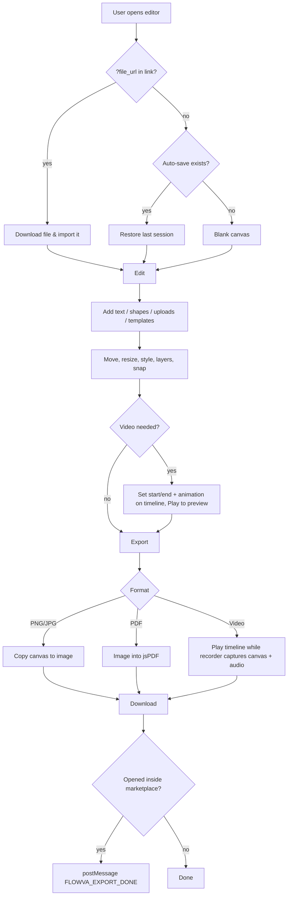
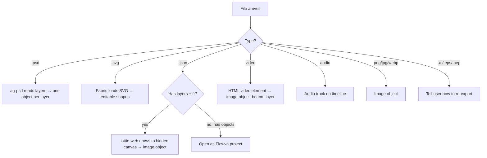
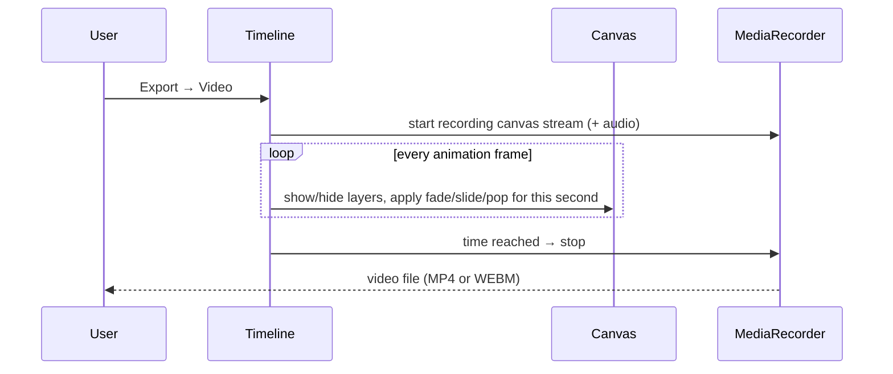

# FlowvaEditor — Beginner's Guide

Everything you need to understand, run, test and deliver the editor. Read it top to bottom once.

---

## 1. What you are building (in plain words)

A **website** (no server needed) that works like a mini Canva:
you open it in a browser, drag text/images/shapes onto a white page, move/resize them, add animation, and click **Export** to get a PNG, JPG, PDF or video.
It also **opens files that designers make in other programs** and lets users keep editing them.

It runs 100% in the browser. "Standalone" means it lives on its own link (e.g. `editor.flowvamarket.com`) and later the main marketplace opens it and receives the result.

---

## 2. The files you received — what each one is

| File / word | What it really is | Where it comes from | What the editor does with it |
|---|---|---|---|
| **PNG / JPG** | A flat picture | Anywhere, AI tools (Midjourney) | Becomes an image layer |
| **SVG** | A picture made of shapes (vector), never blurry | Illustrator → *Save As → SVG* | Becomes editable shapes (change colors) |
| **PSD** | Photoshop file; a stack of **layers** | Photoshop | Each layer becomes its own movable object; text layers become real text |
| **AI / EPS** | Illustrator's own formats (browsers can't read them) | Illustrator | Designer must re-save as SVG |
| **After Effects (.aep)** | The designer's project (browsers can't read it) | After Effects | Designer exports with the **Bodymovin** plugin |
| **Lottie JSON** | A small animation file produced by Bodymovin | After Effects | Plays as a moving layer |
| **MP4 / WEBM** | Video | Sora, Runway, phones | Becomes the bottom video layer |
| **MP3 / WAV** | Audio | Anywhere | Goes on the timeline as music |
| **`.flowva.json`** | **Our own** project save file | The editor's *Save* button | Re-opens the whole design |

**Outputs:** PNG, JPG (pictures), PDF (flyer for print), video (MP4 or WEBM).

Library words from the brief:
- **CDN** = the library is loaded from the internet by a `<script>` line; nothing to install.
- **Fabric.js** = the engine that draws and lets you drag/resize things on a `<canvas>`.
- **ag-psd** = reads PSD files. **lottie-web** = plays Lottie JSON. **jsPDF** = makes PDFs.
- **SortableJS** = drag-to-reorder lists (our Layers panel).
- **Supabase** = an online storage service (optional, to keep exported files).

---

## 3. How to run it (10 minutes)

1. Install **VS Code** → https://code.visualstudio.com/
2. In VS Code install the extension **Live Server** (Extensions icon → search "Live Server").
3. Put the three files in a folder called `flowva-editor`: `index.html`, `style.css`, `editor.js`.
4. Open the folder in VS Code → right-click `index.html` → **Open with Live Server**.
5. The editor opens in your browser. You need internet (libraries load from CDNs). Use **Chrome or Edge**.

Quick test checklist (do these in order; if all work, the project works):
- [ ] Click a template → it appears
- [ ] Double-click text, type, change font on the right
- [ ] Elements → add a circle, drag it, rotate it, change color
- [ ] Ctrl+Z / Ctrl+Y
- [ ] Uploads → upload a PNG, JPG, then an SVG
- [ ] Upload a `.psd` → Layers tab shows each layer
- [ ] Upload a Lottie `.json` (free ones at lottiefiles.com)
- [ ] Upload an MP4, add text, set *Entrance animation = Fade*, press Play, then Export → Video
- [ ] Export PNG and PDF

---

## 4. Problem analysis (how to think about it)

**Problem:** Let non-designers and designers create/edit flyers, images and short videos in the browser and send the result to the marketplace.

**Break it into 6 smaller problems:**

1. **Show a design surface** → a `<canvas>` sized like the design (Instagram post, flyer…).
2. **Make things on it editable** → every item is an *object* with position, size, angle, color, order.
3. **Bring outside files in** → read the file type, convert to objects.
4. **Time** → every object has a *start* and *end* second plus an *animation*; a play-head moves along.
5. **Get files out** → picture = copy the canvas; PDF = put picture in a PDF; video = record the canvas while it plays.
6. **Talk to the marketplace** → open with `?file_url=`, finish with `postMessage`.

**Key decisions I made (and why):**

| Brief said | What I did | Why |
|---|---|---|
| Fabric **and** Konva | **Fabric only** | Two canvas engines fight each other. Fabric alone already does drag/resize. |
| psd.js as backup | Skipped | Old, unmaintained; adds risk. ag-psd is enough. |
| FFmpeg.wasm for MP4 | **Browser's built-in recorder (MediaRecorder)** | FFmpeg.wasm needs special server headers and is slow/heavy for a beginner. Recorder gives MP4 in Chrome/Edge, WEBM in Firefox. Upgrade later if needed. |
| WaveSurfer.js | Not included | Audio shows as a bar on the timeline; waveform trimming is a Phase-2 upgrade. |
| Tailwind CSS | Own `style.css` | Fewer moving parts; same look, easier for you to change colors. |

Tell the owner these changes honestly; they make it more reliable.

---

## 5. Architecture (map of the code)

```
index.html   → the page skeleton + loads all libraries
style.css    → colors, layout (top bar, sidebar, canvas, right panel, timeline)
editor.js    → the brain, 12 numbered sections:
   1 CONFIG        settings you may edit
   2 STATE+CANVAS  Fabric canvas, zoom
   3 HELPERS       names, lock, fonts
   4 HISTORY       undo/redo + autosave (every 10 s)
   5 LEFT PANELS   templates, shapes, text, uploads, brand kit
   6 IMPORT        PNG/SVG/PSD/Lottie/video/audio
   7 ACTIONS       delete, copy, order, align, group
   8 RIGHT PANEL   properties + layers
   9 SNAP GUIDES   magnetic alignment
  10 TIMELINE      play, animations, draggable bars
  11 EXPORT        PNG/JPG/PDF/video + postMessage
  12 START-UP      shortcuts + boot
```

### Overall flowchart



### Importing a file



### Video export



---

## 6. Algorithms in pseudo-code

**Add an object**
```
function addObject(obj):
    give obj a unique id, name, start=0, end=timelineLength, animation="none"
    put obj in the center of the canvas, select it
    save a snapshot for undo
```

**Undo / Redo**
```
history = [], position = -1
on every change:
    text = JSON of whole canvas
    cut off any "redo" future; push text; position++
undo: position--; rebuild canvas from history[position]
redo: position++; rebuild canvas from history[position]
```

**Auto-save**
```
every 10 seconds:
    if something changed: store JSON in browser storage (localStorage)
on start: if saved JSON exists, load it
```

**PSD import**
```
psd = readPsd(file)
set canvas size = psd.width x psd.height
for each layer from bottom to top:
    if group: go inside it
    if text layer: create editable Text (same words, size, color)
    else: turn layer pixels into an image object at (layer.left, layer.top)
    copy name, opacity, hidden, blend mode
add all objects in that order
```

**Timeline playback**
```
remember every object's normal position/opacity ("base")
t = 0
every frame:
    t += seconds since last frame
    for each object:
        visible = (start <= t <= end)
        p = easing( (t - start) / 0.6 )      # 0 → 1 in 0.6 seconds
        fade    : opacity = base * p
        slideUp : y = base.y + (1-p)*distance
        pop     : scale = 0.4 + 0.6*overshoot(p)
    play/pause videos & audio to match t
    if t >= length: stop
when done: put every object back to its "base"
```

**Video export**
```
stream = canvas.captureStream(30 fps)
add the audio tracks to the stream
recorder = MediaRecorder(stream, mp4 if supported else webm)
recorder.start(); play timeline from 0
when timeline ends: recorder.stop() → build file → download
```

**Snap guides**
```
while dragging object:
    for every target line (canvas edges, center, other objects' edges/centers):
        if my edge/center is within 8px of it: jump onto the line and draw a pink guide
```

**Talking to the marketplace**
```
# in the marketplace page (the owner/dev writes this part):
open <iframe src="https://editor.flowvamarket.com/?embed=1&file_url=THE_FILE">
window.addEventListener("message", e =>
    if e.origin == "https://editor.flowvamarket.com" and e.data.type == "FLOWVA_EXPORT_DONE":
        use e.data.payload   # {format, filename, width, height, url or blob}

# in the editor (already coded): after Export
parent.postMessage({ type:"FLOWVA_EXPORT_DONE", payload:{...} }, MARKETPLACE_ORIGIN)
```

---

## 7. Connecting to FlowvaMarket (Step 8 explained)

1. **Deploy** the 3 files to any static host (Netlify, Vercel, Cloudflare Pages, GitHub Pages — all free). Drag-and-drop the folder. Point `editor.flowvamarket.com` to it (the owner adds a DNS record).
2. **Open with a file:** `https://editor.flowvamarket.com/?file_url=https://.../flyer.psd` — the editor downloads and opens it. The file's server must allow **CORS** (otherwise the browser blocks it; the editor then shows a friendly error).
3. **Receive the result:** the marketplace listens for the message `FLOWVA_EXPORT_DONE` (code above). The payload contains `format, filename, width, height` and either `url` (if Supabase is configured) or a `blob` (the file itself).
4. **Security:** in `editor.js` section 1 change `MARKETPLACE_ORIGIN: '*'` to `'https://flowvamarket.com'` (the real address) so only your site can talk to the editor.
5. **Optional Supabase:** create a free account → new project → Storage → make a **public** bucket named `flowva-exports` → paste Project URL and anon key into `SUPABASE_URL` / `SUPABASE_ANON_KEY`. Then exports are uploaded and the marketplace receives a permanent link.

---

## 8. Honest limits (know these before you promise things)

- **Browser needed:** Chrome/Edge best. Safari/Firefox may export WEBM instead of MP4.
- **Video export is real-time:** a 10 s video takes about 10 s to export, and the tab must stay open and visible.
- **PSD:** layers, text, opacity, common blend modes work. Layer effects (drop shadows, strokes), smart objects, adjustment layers and exotic fonts are **not** reproduced; PSD fonts map to the closest Google font.
- **Lottie:** plays and can be moved/scaled; its inner animation can't be edited (that's done in After Effects).
- **Video audio:** audio inside an uploaded MP4 is muted; add music via *Add music*.
- **Large files** (huge PSDs, 4K video) need a good computer.
- **Auto-save** uses browser storage (~5 MB). Very big designs skip it → use the Save button (`.flowva.json`).
- **Templates:** 6 included. The brief asks 20; add more by copying a block in `TEMPLATES` (section 5).
- **Not tested on every device.** Run the checklist in section 3 and tell me exactly which step fails.

---

## 9. Suggested plan with the owner (matches her 4 weeks)

| Week | Goal | Status in this code |
|---|---|---|
| 1 | Flyer editor: text, images, shapes, layers, undo, PNG/JPG | ✅ |
| 2 | PSD, SVG, Lottie | ✅ (see limits) |
| 3 | Video timeline, music, animations, export | ✅ (recorder instead of FFmpeg) |
| 4 | Polish: templates, brand kit, autosave, snap, shortcuts | ✅ except 14 more templates |

**Keyboard shortcuts:** Ctrl+Z/Y undo/redo · Ctrl+C/V copy/paste · Ctrl+D duplicate · Ctrl+S save project · Ctrl+A select all · Del delete · Arrows nudge (Shift = 10px) · Space play/pause · Ctrl+scroll zoom.

---

## 10. If something breaks

1. Press **F12 → Console** in the browser; red text tells you what failed.
2. "fabric is not defined" / blank page → no internet, or a CDN is blocked.
3. PSD does nothing → open Console, send me the message.
4. Export error mentioning CORS → an image came from another website; upload it from your computer instead.

Send me the exact message and I will fix it.